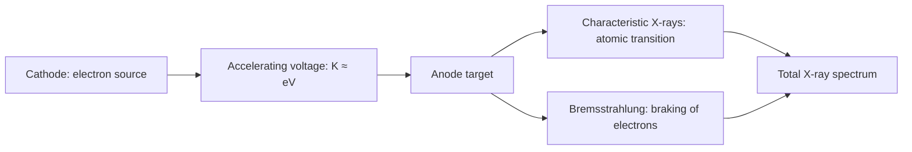
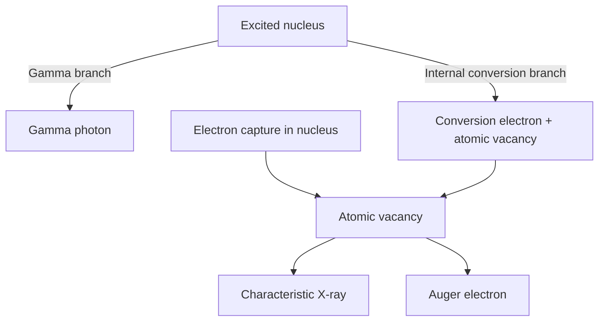

# MP500K · Exam 1 · Complete Five-Module Review

> DKU · Fall 2026 · English concepts + Chinese study scaffolding. Based on Lectures 1–11 and Exam 1 Review Guide.

## Contents

1. [01 L1-L2 Foundations](#module-01)
2. [02 L3-L4 Ionizing Radiation](#module-02)
3. [03 L5-L6 Atomic Structure](#module-03)
4. [04 L7-L9 Xray Attenuation](#module-04)
5. [05 L10-L11 Nuclear Decay](#module-05)

---

<a id="module-01"></a>

# Module 01 — L1–L2: Medical Physics and Modern Physics


**Source:** `Lecture_1.pdf` (overview of medical/radiation physics), `Lecture_2.pdf` (modern physics).  
**Exam guide:** four subspecialties/history/forces/particle–wave duality/classification = **Basic**; fundamental particles/relativity/uncertainty = **Solid**.

## L1 — Overview of Medical Physics

### 1. Medical physics as a multidisciplinary field

Medical physics applies **physics, mathematics, chemistry, engineering, computing/AI, and biology** to medicine. L1 describes three career directions: **clinic, industry, research**.

Four subspecialties:

| Subspecialty | Main work | Typical technologies |
|:--|:--|:--|
| Diagnostic imaging physics | Image quality, acquisition and patient safety | X-ray, CT, MRI, ultrasound |
| Radiation therapy physics | Treatment delivery and dosimetry | LINAC, proton beams, brachytherapy |
| Nuclear medicine physics | Radiotracer imaging and therapy | PET, SPECT |
| Health physics / radiation protection | Risk control and shielding | Time, distance, shielding |

**Ionizing imaging:** X-ray radiography, CT, PET, SPECT. **Non-ionizing:** MRI, ultrasound. The imaging modality can be the same diagnostic goal but use a very different physical mechanism.

### 2. Historical context

Core milestones highlighted in lecture/homework context include **Röntgen's X-rays (1895)**, **Becquerel's radioactivity (1896)**, research by **the Curies**, **Bohr's atomic model (1913)**, and later medical applications including **Co-60 therapy, CT, MRI and PET**. Nobel details often confused: **Röntgen — 1901 Physics**; **Einstein — 1921 Physics, especially photoelectric law**; **CT: Cormack/Hounsfield — 1979 Medicine**; **MRI: Lauterbur/Mansfield — 2003 Medicine**.

### 3. Radiation protection essentials

- **Time:** at constant dose rate, accumulated exposure increases with time.
- **Distance:** an ideal point source in free space follows approximately $I\propto 1/r^2$.
- **Shielding:** use suitable material/thickness, considering spectrum, workload, geometry and occupancy.

## L2 — Review of Basic Concepts in Modern Physics

### 1. Four fundamental forces

| Force | Approx. relative strength (lecture convention) | Typical range | Relevance |
|:--|--:|:--|:--|
| Strong | $1$ | $\sim10^{-15}\ \mathrm m$ | Nuclear binding |
| Electromagnetic | $1/137$ | Long-range | Atomic interactions, charged particles |
| Weak | $\sim10^{-6}$ | $\sim10^{-18}\ \mathrm m$ | Beta decay |
| Gravitational | $\sim10^{-39}$ | Long-range | Negligible in atomic-scale radiation physics |

These strengths are **order-of-magnitude teaching conventions**, not universal energy-independent ratios.

### 2. Fundamental particles

- **Quarks:** up ($+2e/3$), down ($-e/3$), and four additional flavors. Proton $uud$; neutron $udd$.
- **Hadrons:** particles subject to strong interactions; includes baryons (proton/neutron) and mesons.
- **Leptons:** electron, muon, tau and corresponding neutrinos. Neutrino and antineutrino must not be swapped when writing beta decay.

### 3. Classification of radiation

**Directly ionizing:** charged particles (electron, positron, proton, alpha, carbon ions) deposit energy via Coulomb interactions.  
**Indirectly ionizing:** uncharged photons/neutrons first create energetic charged particles, which then ionize matter.

### 4. Special relativity and relativistic relations

Define $\beta=v/c$ and the **Lorentz factor**:

$$
\gamma=\frac{1}{\sqrt{1-\beta^2}}.
$$

| Quantity | Equation | Interpretive caution |
|:--|:--|:--|
| Time dilation | $\Delta t=\gamma\Delta\tau$ | $\Delta\tau$ is proper time |
| Length contraction | $L=L_0/\gamma$ | Along direction of relative motion |
| Total energy | $E=\gamma m_0c^2$ | Includes rest energy |
| Rest energy | $E_0=m_0c^2$ | Electron: 0.511 MeV |
| Kinetic energy | $K=(\gamma-1)m_0c^2$ | $K\ne E$ |
| Momentum | $p=\gamma m_0v$ | $p$ is not generally $m_0v$ |
| Energy–momentum | $E^2=(pc)^2+(m_0c^2)^2$ | Works for massive particles and photons |

**Terminology:** Some homework asks for “relativistic mass” $\gamma m_0$; modern treatments commonly retain invariant rest mass $m_0$.

### 5. Particle–wave duality

For a **photon**:

$$
E=h\nu=\frac{hc}{\lambda},\qquad p=\frac E c=\frac h\lambda.
$$

For a **material particle** (de Broglie relation):

$$
\lambda=\frac hp.
$$

- Higher photon frequency $\nu$ means higher photon energy.
- Shorter wavelength $\lambda$ means higher photon energy.
- Distinguish Greek **$\nu$ (frequency)** from Latin **$v$ (speed)**.

### 6. Heisenberg uncertainty principle

$$
\Delta x\,\Delta p_x\ge\frac{\hbar}{2},\qquad \Delta E\,\Delta t\gtrsim\frac{\hbar}{2}.
$$

Position and conjugate momentum cannot simultaneously have arbitrary precision; the energy–time relation has a distinct interpretation from a pair of position/momentum operators.

## Concept connections


### Can you explain without notes?

- Why is PET ionizing but MRI non-ionizing?
- Why is $K=(\gamma-1)m_0c^2$ instead of $\gamma m_0c^2$?
- Why do photons of different energies still travel at $c$ in vacuum?

---

<a id="module-02"></a>

# Module 02 — L3–L4: Ionizing Radiation and Radiation Fields


**Source:** `Lecture_3.pdf` (original L3 & L4 joint lecture, pp. 1–24), `Lecture_4.pdf` (continuation, pp. 1–16).  
**Exam guide:** radiation classification, precision, four fluence quantities = **Basic**; differential/alternative/planar fluence = **Advanced**.

## 1. Introduction

**Ionizing radiation** has sufficient energy to detach electrons from atoms/molecules. **Excitation** raises a bound electron to another bound state; **ionization** removes it from the atom.

- **Radiological physics:** ionizing radiation, its interactions with matter, and the energy transferred/absorbed.
- **Radiation dosimetry:** quantitative assessment of radiation energy deposition.
- Lecture examples include medicine, nuclear reactors, screening, industrial radiography, sterilization and chemical modification.

## 2. Types and sources

| Type | Key physical origin/description |
|:--|:--|
| X-ray | Atomic transitions (characteristic), or acceleration/deceleration (bremsstrahlung) |
| Gamma ray | Nuclear transitions; annihilation photons may also be described as gamma rays |
| Fast electron | Photoelectron, Compton electron, beta, delta ray, Auger, IC, etc. |
| Heavy charged particle | Proton, deuteron, triton, alpha, heavier ions |
| Neutron | Nuclear sources/reactions; uncharged, indirectly ionizing |

**X-ray vs gamma ray:** principal distinction is **origin**, not photon energy; both obey $E=h\nu=hc/\lambda$.

For slow neutrons the nonrelativistic relation is $K=\tfrac12mv^2$. Thermal-neutron benchmark (lecture): **$K\approx0.025\ \mathrm{eV}$**, **$v\approx2200\ \mathrm{m/s}$**. Heavier charged particles require relativistic kinematics at sufficiently high energy.

**Direct ionization:** fast charged particle → repeated Coulomb interactions → ionization/excitation.  
**Indirect ionization:** photon/neutron → energetic secondary charged particle → ionization/excitation.

## 3. Random nature of radiation fields

### Stochastic vs non-stochastic

Single detected **counts** are stochastic (vary between repeated measurements). Expected fluence/rate are defined as **non-stochastic** quantities under fixed conditions.

For Poisson counting with mean $\Lambda$:

$$
P(N=k)=\frac{\Lambda^k e^{-\Lambda}}{k!},\quad
\mathbb E[N]=\mathrm{Var}(N)=\Lambda,\quad
\sigma_N=\sqrt{\Lambda}\approx\sqrt N.
$$

For large $\Lambda$, Poisson counts can be approximately normal. The normal distribution does **not** generally satisfy variance = mean; that equality comes from the underlying Poisson model.

With $n$ independent repeated equal-duration measurements:

$$
\mathrm{SEM}=\frac{\sigma_N}{\sqrt n},\qquad
\frac{\sigma_N}{\Lambda}=\frac1{\sqrt\Lambda},\qquad
\frac{\mathrm{SEM}}{\Lambda}=\frac1{\sqrt{n\Lambda}}.
$$

If measuring $N$ counts during a known time $t$:

$$
R=\frac Nt,\qquad \sigma_R\approx\frac{\sqrt N}{t}.
$$

**Interpretation:** More counts reduce **relative** counting uncertainty, although the absolute standard deviation $\sqrt N$ increases.

Sample standard deviation from repetitions:

$$
s=\sqrt{\frac1{n-1}\sum_{i=1}^n(N_i-\overline N)^2}.
$$

## 4. Description of the radiation field

| Quantity | Symbol and definition | Units |
|:--|:--|:--|
| Fluence | $\Phi=dN_e/da$ | $\mathrm{m^{-2}}$ or $\mathrm{cm^{-2}}$ |
| Fluence rate | $\varphi=d\Phi/dt$ | $\mathrm{m^{-2}\,s^{-1}}$ |
| Energy fluence | $\Psi=dR/da$ | $\mathrm{J\,m^{-2}}$ |
| Energy fluence rate | $\psi=d\Psi/dt$ | $\mathrm{J\,m^{-2}\,s^{-1}}$ |

$N_e$ is **expected particle count**, $R$ is expected radiation energy, and $da$ is the **great-circle area of an infinitesimal sphere**. Do not silently substitute the area of a fixed plane.

For **monoenergetic** radiation of energy $E$:

$$
\Psi=E\Phi,\qquad\psi=E\varphi.
$$

**Fluence rate ≠ count rate:** fluence rate has a per-area factor; the detector count rate may also depend on efficiency and response.

## 5. Differential distribution vs energy and angle

A differential fluence rate can depend on energy $E$ and direction $(\theta,\beta)$:

$$
\varphi'(\theta,\beta,E)=\frac{d\varphi}{d\Omega\,dE},\qquad
d\Omega=\sin\theta\,d\theta\,d\beta.
$$

Total over angles and energies:

$$
\varphi=\int_0^\pi\int_0^{2\pi}\int_0^{E_{\max}}
\varphi'(\theta,\beta,E)\sin\theta\,dE\,d\beta\,d\theta.
$$

Energy-only spectrum after angle integration:

$$
\varphi=\int\varphi'(E)\,dE,\qquad
\psi'(E)=E\varphi'(E),\qquad
\psi=\int E\varphi'(E)\,dE.
$$

**Figure interpretation (L4 pp. 6–7):** area under particle-fluence spectrum = total **particle fluence rate**. Area under energy-weighted spectrum = total **energy fluence rate**. Even if $\varphi'(E)$ is flat, $\psi'(E)$ increases linearly with $E$.

## 6. Alternative definitions and planar fluence

**Chilton's theorem / track-length formulation:**

$$
\Phi=\lim_{\Delta V\to0}\frac{\mathbb E[\sum_i\Delta \ell_i]}{\Delta V}.
$$

The sum of tracks has units of length; divided by volume gives inverse area, consistent with fluence.

**Planar fluence:** crossings of a *fixed plane* are counted from either side with **scalar** addition. For a beam making angle $\theta$ with the surface normal:

$$
\Phi_p=\Phi\,|\cos\theta|.
$$

For an isotropic field:

$$
\frac{\varphi_p}{\varphi}=
\frac{\int_0^\pi|\cos\theta|\sin\theta\,d\theta}{\int_0^\pi\sin\theta\,d\theta}=\frac12.
$$

**Net flow** instead uses the signed $\cos\theta$ and is **zero** for an isotropic field. The absolute value matters: the lecture describes crossings **in either direction**.

### Can you explain without notes?

- Standard deviation vs standard error of the mean?
- Difference between $\Phi$, $\varphi$, $\Psi$ and $\psi$?
- Why does an isotropic field have planar fluence rate $\varphi/2$, but zero net flow?

---

<a id="module-03"></a>

# Module 03 — L5–L6: Atomic Structure


**Source:** `Lecture_5.pdf` pp. 3–32; `Lecture_6.pdf` pp. 2–22.  
**Exam guide:** atomic models, hydrogen energy diagram, quantum numbers and electron configuration = **Basic**; Bohr electron and spectral series = **Solid**; multi-electron atoms = **Advanced**.

## L5 · 1. Basic models of the atom

| Model | Core proposal | Limitation |
|:--|:--|:--|
| Dalton | Elements consist of atoms; simple whole-number ratios in compounds | Atoms actually have substructure |
| Thomson (1897) | Electrons embedded in positively charged sphere; **no nucleus** | Cannot explain large-angle alpha scattering |
| Rutherford (1911) | Tiny dense positive nucleus, most of atom empty | Accelerating classical orbit electron should radiate/collapse |
| Bohr (1913) | Allowed quantized nonradiating electron orbits and transitions | Simplified hydrogen-like model |

**Bohr's four postulates (lecture pp. 7–8):**

1. Coulomb attraction provides centripetal force, $m_ev^2/r=Ze^2/(4\pi\varepsilon_0r^2)$.
2. Electron does **not** radiate in an allowed stationary orbit.
3. Allowed orbital angular momentum is quantized: $L=n\hbar$, with $n=1,2,\dots$.
4. An electron transition exchanges a photon of energy $\lvert E_i-E_f\rvert=h\nu=hc/\lambda$.

## L5 · 2. Properties of Bohr electron

For **one-electron atoms/ions** with a heavy-nucleus, nonrelativistic approximation:

$$
\boxed{r_n=a_0\frac{n^2}{Z}},\qquad a_0=5.29\times10^{-11}\ \mathrm m=0.529\ \text{Å}
$$

$$
\boxed{v_n=\alpha c\frac Z n},\qquad\alpha\simeq1/137
$$

$$
\boxed{E_n=-13.6\frac{Z^2}{n^2}\ \mathrm{eV}}
$$

For ground-state hydrogen ($n=Z=1$): $r_1=0.529\ \text{Å}$, $v_1\approx2.19\times10^6\ \mathrm{m/s}$, $E_1=-13.6\ \mathrm{eV}$.

**Meaning of negative energy:** the zero is defined at an electron/nucleus infinite separation (ionization limit). A bound electron is below that energy. The formula is **not** universally valid for every electron of a multi-electron atom.

## L5 · 3. Energy levels and transitions

**Hydrogen energy diagram (lecture pp. 16–18):**

| $n$ | $E_n$ (eV) |
|:--:|--:|
| 1 | −13.60 |
| 2 | −3.40 |
| 3 | −1.51 |
| 4 | −0.85 |
| $\infty$ | 0.00 |

- **Excitation:** bound state $i\to f$ with $E_f>E_i$; $E_{exc}=E_f-E_i$.
- **Ionization:** bound electron removed to continuum threshold $E_\infty=0$; $E_{ion}=0-E_i$.
- **Emission:** upper $n_i$ to lower $n_f$, photon energy $E_\gamma=E_i-E_f>0$.
- **Absorption:** supplies the positive energy needed to move to a higher electronic state.

**Balmer empirical formula**, with $n_i\ge3$ and final $n_f=2$:

$$
\lambda=3646\frac{n_i^2}{n_i^2-4}\ \text{Å}.
$$

**Rydberg formula** for hydrogen:

$$
\frac1\lambda=R_\infty\left(\frac1{n_f^2}-\frac1{n_i^2}\right),\qquad
R_\infty=1.097373\times10^7\ \mathrm{m^{-1}}.
$$

| Series | $n_f$ | Region |
|:--|--:|:--|
| Lyman | 1 | Ultraviolet |
| Balmer | 2 | Visible (major lines) / limit near UV |
| Paschen | 3 | Infrared |
| Brackett | 4 | Infrared |

**Series identity is fixed by $n_f$, not $n_i$.** For any fixed $n_f$, longest wavelength comes from $n_i=n_f+1$ (smallest transition energy), shortest from $n_i\to\infty$ (series limit).

## L5 · 4. Correction for finite nuclear mass

The nucleus is not infinitely heavy: electron and nucleus orbit their mutual center of mass. Use **reduced mass**:

$$
\mu_r=\frac{m_eM}{m_e+M},\qquad R_H=\frac{\mu_r}{m_e}R_\infty.
$$

Lecture values: $R_H\approx1.09678\times10^7\ \mathrm{m^{-1}}$. Special systems: **positronium** ($e^+e^-$) and **muonic atoms** (nucleus + negative muon). Differences in reduced mass alter level energies.

## L5 · 5. Multi-electron atoms (Advanced)

The electron experiences nuclear attraction **and** electron–electron repulsion. A simple Hartree-inspired effective-charge picture uses:

$$
V(r)\approx-\frac{Z_{eff}e^2}{4\pi\varepsilon_0r}.
$$

This illustrates **shielding**. The slide's simple $Z_{eff}$ recipes are not general exact rules: energy in many-electron atoms depends on both $n$ and $l$ and on interactions, spin–orbit effects, etc.

## L6 · 6. Electron quantum numbers

| Name | Symbol | Allowed values | Meaning |
|:--|:--:|:--|:--|
| Principal | $n$ | $1,2,3,\ldots$ | Shell (K, L, M, N, …) |
| Orbital | $l$ | $0,1,\ldots,n-1$ | Subshell (s,p,d,f,g,…) |
| Magnetic | $m_l$ | $-l,\ldots,l$ | Orbital angular momentum projection |
| Spin | $m_s$ | $\pm1/2$ | Electron spin projection |

**Angular momenta:**

$$
L=\sqrt{l(l+1)}\hbar,\qquad L_z=m_l\hbar.
$$

Be careful: **Bohr's** $L=n\hbar$ and **quantum mechanical** $L=\sqrt{l(l+1)}\hbar$ come from different models.

| $l$ | Subshell | Number of orbitals $2l+1$ | Max electrons $2(2l+1)$ |
|--:|:--:|--:|--:|
| 0 | s | 1 | 2 |
| 1 | p | 3 | 6 |
| 2 | d | 5 | 10 |
| 3 | f | 7 | 14 |

A full principal shell has:

$$
N_{orbitals}=n^2,\qquad N_{electron\ states}=2n^2.
$$

**Pauli exclusion principle (lecture p. 11):** no two electrons in one atom may share the same set $(n,l,m_l,m_s)$. Therefore each spatial orbital admits at most **two electrons of opposite spin**.

## L6 · 7. Atomic electron configuration

**Aufbau principle:** occupy generally lower-energy orbitals first. A standard order is:

```text
1s → 2s → 2p → 3s → 3p → 4s → 3d → 4p → 5s → 4d → 5p
   → 6s → 4f → 5d → 6p → ...
```

**Hund's rule:** among *degenerate* orbitals of the same subshell, occupy them singly with parallel spins before pairing.

**Pauli principle:** at most 2 electrons per orbital; spins opposed when paired.

Examples from the lecture:

| Neutral atom | Ground-state configuration |
|:--|:--|
| H | $1s^1$ |
| B | $1s^22s^22p^1$ |
| N | $1s^22s^22p^3$ |
| F | $1s^22s^22p^5$ |
| Na | $1s^22s^22p^63s^1$ |

For neutral atoms, total electrons = $Z$. Some configurations deviate from a naïve filling sequence because orbitals are close in energy; the order is a teaching guide rather than an exceptionless law.

### Quick conceptual checks

- Why is **3f** forbidden but **4f** allowed? ($l\le n-1$)
- For a 2p subshell, how many *orbitals* vs *electron states*?
- Why is a **2p³** ground-state occupancy `↑ ↑ ↑` rather than `↑↓ ↑ _`?

---

<a id="module-04"></a>

# Module 04 — L7–L9: X-ray Production, Quality and Attenuation


**Source:** `Lecture_7.pdf` (X-ray production/characteristic), `Lecture_8.pdf` (bremsstrahlung and quality), `Lecture_9.pdf` (attenuation).  
**Exam guide:** X-ray production/quality and exponential attenuation = **Basic**; beam hardening, narrow/broad beam, buildup = **Solid**.

## L7 · 1–2. Properties of X-rays

X-rays are photons with $E=h\nu=hc/\lambda$ and $p=h/\lambda=E/c$. Lecture's approximate range: **0.1–1000 keV**. X-ray tube voltage determines accelerating-electron energy; distinguish **kVp** (tube voltage) from **keV** (photon energy).

## L7 · 3. X-ray tube and production



### Characteristic X-rays

An inner-shell electron is ejected → vacancy → outer-shell electron transitions inward → emits **characteristic photon** (or releases **Auger electron**, a competing atomic relaxation).

$$
E_X\approx B_{inner}-B_{outer}.
$$

| Transition | Label | Relative energy |
|:--|:--|:--|
| L → K | Kα | Lower than Kβ |
| M → K | Kβ | Higher than Kα |
| N → K | Kγ | Higher than Kβ (simplified ordering) |

**Tungsten peaks (L7 p. 17):** Kα₁ ≈ 59.32 keV, Kα₂ ≈ 57.98 keV, Kβ₁ ≈ 67.24 keV. The fine structure of electron subshells creates closely spaced lines.

**Fluorescence yield $\omega$:** probability that a specified shell vacancy relaxes radiatively (via characteristic X-ray). In a simple radiative vs non-radiative partition, Auger probability ≈ $1-\omega$. Higher-$Z$ atoms generally have greater **K-shell fluorescence yield**. This probability is **not** photon escape probability.

## L8 · 3. Bremsstrahlung

A fast electron loses a variable amount of kinetic energy through electromagnetic interaction with a nucleus. The emitted photon energies form a **continuous spectrum**:

$$
E_\gamma=K_i-K_f,\qquad E_{\gamma,max}\approx K_i\approx eV_{max}.
$$

**Duane–Hunt law:**

$$
\lambda_{min}=\frac{hc}{E_{\gamma,max}}=\frac{hc}{eV_{max}}.
$$

**Thin-target approximation:** lecture illustrates nearly constant differential **radiant-energy spectrum**, $R(E)=N(E)E\approx C$.  
**Thick-target approximation (lecture units $T_0$ in MeV):**

$$
R\approx10^{-3}N_eZT_0^2\ \mathrm{MeV},\qquad
Y\approx10^{-3}ZT_0.
$$

These are **approximate** teaching formulas, not general equipment calibration laws.

**Interpret spectrum comparisons (L8 p. 9):**

- Raise electron count $N_e$ → quantity scales up, cutoff $E_{max}$ unchanged.
- Raise target $Z$ in the simplified model → more bremsstrahlung, similar endpoint.
- Raise initial electron kinetic energy $T_0$ → higher endpoint and substantially larger integrated radiation energy.

### Spectrum anatomy

```text
Intensity
  ^                 | Kα   | Kβ      Discrete characteristic lines
  |        _____    |      |
  |      /      \   |      |
  |_____/        \__|______|____________> Photon energy
                         continuous bremsstrahlung → endpoint Emax
```

The schematic illustrates components, **not a measured spectrum**. The continuous background goes to a maximum energy; characteristic peaks sit at material-dependent energies.

## L8 · 4. Quantity, quality and beam hardening

| Quantity | Quality |
|:--|:--|
| Number/output of photons | Penetrability and spectral hardness |
| Primarily mA and exposure time (mAs) | Strongly influenced by kVp and filtration |

**HVL:** absorber thickness giving half the **measured** intensity. For a monoenergetic narrow beam:

$$
HVL=\frac{\ln2}{\mu}.
$$

**Beam hardening:** a polychromatic beam loses low-energy photons preferentially, so its **mean transmitted energy increases** while **total fluence/energy fluence generally decreases**. No individual photon is “hardened.” See **L8 pp. 11–12** diagrams (low-energy region disproportionately suppressed).

Near regions away from absorption edges, photoelectric mass attenuation may be illustrated by the approximate scaling $\tau/\rho\propto Z^3/E^3$. This is **not** an exact all-energy expression.

## L8 · 5. Filtration

- **Inherent filtration:** target, X-ray tube glass, insulating oil and other built-in materials.
- **Added filtration:** selected materials such as aluminum or copper.
- **Purpose:** remove photons with little useful penetration but substantial patient absorption; modify beam quality.
- Higher-$Z$ filters can introduce absorption-edge features; lower-$Z$ filtration may produce smoother spectra.

**Distinction:** *filtration* is an engineered method; *beam hardening* is the resulting spectral selection effect. Filtering does **not** produce a perfectly monoenergetic spectrum.

## L9 · 1–2. Exponential attenuation

Primary, *uncollided* photons of a **monoenergetic**, well-defined beam in a **homogeneous** material follow:

$$
I(L)=I_0e^{-\mu L},\qquad N_L=N_0e^{-\mu L}.
$$

- $\mu$ = **linear attenuation coefficient**, units $\mathrm{cm^{-1}}$ or $\mathrm{m^{-1}}$.
- For a short distance $dL$, interaction probability ≈ $\mu\,dL$.
- Derivation: $dN/N=-\mu\,dL$; integrate $\Rightarrow\ln(N_L/N_0)=-\mu L$.
- **Microscopic interpretation:** $e^{-\mu L}$ is one particle's probability of **no interaction**.
- **Macroscopic interpretation:** expected surviving **uncollided fraction** of many particles.

$$
\lambda_{mfp}=\frac1\mu,\qquad HVL=\frac{\ln2}{\mu}.
$$

After one mean free path, survival $e^{-1}\approx36.8\%$ (not zero). With multiple interaction channels:

$$
\mu=\sum_i\mu_i,\qquad
\Delta N_i=(N_0-N_L)\frac{\mu_i}{\mu}.
$$

An interaction that removes a photon from the **primary beam** may be scattering rather than complete energy absorption.

## L9 · 3. Narrow-beam attenuation

**Only uncollided primary particles count.** A collimated narrow-beam detector geometry helps reject scattered/secondary photons; published narrow-beam coefficients usually refer to this primary-only definition. A physically broad detector can still measure primary-only signal if it **discriminates** nonprimaries by direction, energy or other method (L9 p. 18).

## L9 · 4. Broad-beam attenuation

**Some scattered and/or secondary radiation reaches and is counted by the detector.** Broad beam is a **measurement/geometry-dependent** response, not a new intrinsic material attenuation coefficient.

- **Out-scattering:** particles initially directed toward detector scatter away.
- **In-scattering:** particles initially headed elsewhere scatter into detector.
- L9 pp. 20–21 plot compares narrow vs broad geometries; more broad geometry may mean more detected scatter and slower apparent attenuation. The lecture's plot uses **fast neutrons through steel** as an illustrative example.

## L9 · 5. Buildup factor

For a specified quantity (e.g. energy fluence, exposure or dose):

$$
B=\frac{\text{primary + scattered + secondary contribution}}{\text{primary-only contribution}}.
$$

For **energy fluence**, matching quantity to numerator and denominator:

$$
B=\frac{\Psi_P+\Psi_S+\Psi_{2nd}}{\Psi_P},\qquad
\frac{\Psi_L}{\Psi_0}=Be^{-\mu L}.
$$

Define effective coefficient for a **specified** thickness/geometry:

$$
Be^{-\mu L}=e^{-\mu' L}\quad\Rightarrow\quad
\boxed{\mu'=\mu-\frac{\ln B}{L}}.
$$

- **Narrow beam:** $B=1$ (primary only).
- **Broad beam:** typically $B>1$ when scattered/secondary contributions are counted.
- For $B>1$, $\mu'<\mu$ is the **apparent/effective** coefficient; the narrow-beam material $\mu$ did **not** change.

**L9 p. 24 buildup charts:** horizontal axis $\mu L$ counts **mean free paths**, not cm; curves depend on **material, energy, geometry and measured quantity**. An **exposure** buildup factor cannot automatically be reused as an **energy-fluence** buildup factor.

### Can you explain without notes?

- Why can increasing kVp change the endpoint while increasing mAs cannot?
- Why can energy fluence decline while mean transmitted photon energy rises?
- Why does a broad-beam setup need a buildup factor when a primary-only measurement does not?

---

<a id="module-05"></a>

# Module 05 — L10–L11: Nuclear Structure and Radioactive Decay


**Source:** `Lecture_10.pdf` pp. 3–40; `Lecture_11.pdf` pp. 3–30.  
**Exam guide:** nuclear structure, Coulomb force/potential, nuclides, stability, binding energy, decay modes = **Basic**; shell model and decay energy = **Solid**; liquid drop model = **Advanced**.

## L10 · 1–2. Basic structure of the nucleus

The nucleus consists of **protons** ($+e$, $m_pc^2\approx938.272\ \mathrm{MeV}$) and **neutrons** (neutral, $m_nc^2\approx939.565\ \mathrm{MeV}$). Both are spin-$1/2$ **nucleons**.

### Coulomb and strong nuclear forces

$$
F_C=\frac{k_0q_1q_2}{r^2},\qquad U_C=\frac{k_0q_1q_2}{r},\qquad
k_0=\frac1{4\pi\varepsilon_0}.
$$

- Two protons repel electrically; as they approach, their **positive Coulomb potential energy** increases.
- The **strong nuclear force** is attractive over a short, roughly femtometer range and acts approximately independent of nucleon electric charge.
- **L10 pp. 8–9 diagrams:** proton–nucleus potential has an external **Coulomb barrier** and an attractive interior **nuclear well**. A neutron has no corresponding electric repulsive barrier, though nuclear reaction probability still depends on energy/cross section.

### Nuclide notation and categories

$$
{}^A_ZX,\qquad A=Z+N,
$$

where $Z$ = protons, $N$ = neutrons and $A$ = nucleons.

| Category | Invariant | Example (L10 p. 11) |
|:--|:--|:--|
| **Isotopes** | Same $Z$ | $^{16}O,\ ^{17}O$ |
| **Isotones** | Same $N$ | $^{13}C,\ ^{14}N$ |
| **Isobars** | Same $A$ | $^{14}C,\ ^{14}N$ |
| **Isomers** | Same $Z,A$, different nuclear states | $^{99m}Tc,\ ^{99}Tc$ |

### Radius and density

**Lecture 10 convention** (p. 13):

$$
R=r_0A^{1/3},\qquad r_0\approx1.3\ \mathrm{fm},\qquad 1\ \mathrm{fm}=10^{-15}\ \mathrm m.
$$

Since $R^3\propto A$ and nuclear mass $\propto A$, the approximate nuclear density is **roughly constant**, $\rho\approx1.8\times10^{17}\ \mathrm{kg/m^3}$ (lecture example). Different references may use $r_0\sim1.2\ \mathrm{fm}$—**do not silently mix conventions**.

## L10 · 3. Stability of nucleus

The nucleus balances short-range attractive binding with long-range proton–proton electrostatic repulsion. In the **$N$–$Z$ chart** (L10 p. 15):

- For light stable nuclei, $N/Z\approx1$.
- Heavier stable nuclei increasingly require **neutron excess**; stable band bends above $N=Z$.
- With **$Z$ horizontal** and **$N$ vertical**: isotopes = vertical lines, isotones = horizontal lines, isobars = $N+Z=\mathrm{constant}$ diagonals.
- This is a **stability band** trend, not an absolute criterion. Shell closures, pairing and energy balance also matter.

## L10 · 4. Mass defect and binding energy

A bound nucleus has less rest mass than separate nucleons:

$$
\Delta m=Zm_p+(A-Z)m_n-M_{nucleus},\qquad
BE=\Delta m\,c^2.
$$

Useful conversion:

$$
1\ \mathrm u\,c^2=931.494\ \mathrm{MeV}.
$$

**Atomic mass bookkeeping:** if using **neutral atomic** mass $M_{atom}$, a convenient approximate form is:

$$
BE\approx[Zm_H+(A-Z)m_n-M_{atom}]c^2,
$$

where $m_H$ = **neutral hydrogen-atom mass**. Do not combine a neutral-atom mass with bare proton mass without accounting for electrons.

### Binding energy per nucleon and the curve

$$
\frac{BE}{A}\ \text{(MeV/nucleon)}.
$$

**L10 pp. 23–25:** binding energy per nucleon rises rapidly at low $A$, has a broad maximum in the **Fe/Ni region**, then falls gradually for heavy nuclei.

- **Fusion:** some light nuclei combine into a more tightly bound final system; release energy if final total rest mass decreases.
- **Fission:** some heavy nuclei fragment into more tightly bound products; release energy if final total rest mass decreases.

**Important distinction:** high $BE/A$ signals average nucleon binding, not proof of absolute stability against all decay channels.

## L10 · 5. Liquid drop model (Advanced)

Nucleons are treated collectively like constituents of a nearly constant-density fluid droplet. Lecture's five terms:

1. **Volume:** $+C_1A$ — bulk attractive binding.
2. **Surface:** $-C_2A^{2/3}$ — surface particles have fewer neighbors.
3. **Coulomb:** $-C_3Z(Z-1)/A^{1/3}$ — proton repulsion.
4. **Asymmetry:** $-C_4(A-2Z)^2/A$ — imbalance of proton and neutron populations.
5. **Pairing:** $+C_5C_p/A$ — lecture-specific parametrization of even/odd energy correction.

**Lecture 10 p. 31 form:**

$$
BE=C_1A-C_2A^{2/3}-C_3\frac{Z(Z-1)}{A^{1/3}}-
C_4\frac{(A-2Z)^2}{A}+C_5\frac{C_p}{A}.
$$

**Lecture coefficients (MeV):** $C_1=15.75$, $C_2=17.80$, $C_3=0.711$, $C_4=23.70$, $C_5=11.18$. $C_p=+1$ for even–even, $0$ for odd $A$, $-1$ for odd–odd nuclei.

**Source note:** alternative textbooks use a *different power of $A$* and fitted coefficients for the pairing term; this expression preserves **this lecture's convention**, not an interchangeable universal parametrization.

The liquid drop model averages nucleons; it does not directly explain **magic numbers**.

## L10 · 6. Nuclear shell model (Solid)

Treat proton and neutron motion through **quantized nuclear energy levels**, with substantial spin–orbit splitting.

**Magic numbers:**

$$
\boxed{2,\ 8,\ 20,\ 28,\ 50,\ 82,\ 126}.
$$

A complete proton or neutron shell often yields extra stability. Proton and neutron occupation patterns are treated **separately**.

### Subshell labels

A label such as $1d_{5/2}$ means:

- **1**: radial level/index in the **nuclear** notation.
- **d**: orbital angular momentum $l=2$.
- **5/2**: total nucleon angular momentum $j=5/2$.

For spin-$1/2$ nucleons:

$$
j=l\pm\frac12,\qquad \boxed{\text{capacity of subshell}=2j+1}.
$$

| Subshell | $j$ | Capacity per nucleon species |
|:--|:--:|--:|
| $1s_{1/2}$ | $1/2$ | 2 |
| $1p_{3/2}$ | $3/2$ | 4 |
| $1p_{1/2}$ | $1/2$ | 2 |
| $1d_{5/2}$ | $5/2$ | 6 |
| $2s_{1/2}$ | $1/2$ | 2 |
| $1d_{3/2}$ | $3/2$ | 4 |
| $1f_{7/2}$ | $7/2$ | 8 |

**L10 p. 37 figure:** after filling cumulative capacities **2, 8, 20, 28**, observe corresponding magic numbers. The $1p$, $1d$, etc. states split because of **nuclear spin–orbit coupling**.

### Nuclear ground-state spin $J$

- **Even–even:** typically $J=0$.
- **Odd-A:** typically determined by the unpaired nucleon's $j$.
- **Odd–odd:** unpaired proton and neutron angular momenta must be **coupled**; in general $J=|j_p-j_n|,\ldots,j_p+j_n$, with actual ground state set by interactions.

Lecture example **$^{17}O$** has $Z=8$ and $N=9$; one neutron occupies $1d_{5/2}$ beyond the 8-neutron closure, producing $J=5/2$ in the simple shell picture.

## L11 · 1. Radioactive decay and conservation

**Radioactivity:** spontaneous disintegration/rearrangement of an unstable nucleus, accompanied by radiation. **Parent** → **daughter** + emitted particles/radiation. Conservation of charge, nucleon number, energy (including rest mass), momentum and angular momentum; beta processes also require lepton-number bookkeeping.

## L11 · 2. Alpha decay and Q value

$$
{}^A_ZP\longrightarrow{}^{A-4}_{Z-2}D+{}^4_2He,
$$

$$
Q_\alpha=(M_P-M_D-M_\alpha)c^2.
$$

Here the formula uses **nuclear masses**; neutral atomic masses require consistent helium-atom mass bookkeeping. For an initially stationary parent, a two-body, nonrelativistic decay:

$$
Q_\alpha=K_D+K_\alpha,\qquad
K_\alpha=Q_\alpha\frac{M_D}{M_D+M_\alpha}\approx Q_\alpha\frac{A-4}{A}.
$$

Equal-and-opposite daughter/alpha momentum implies the **lighter alpha** takes most of the kinetic energy. Fixed two-body branch → a **discrete alpha energy**.

## L11 · 3. Decay scheme and branches

A **decay scheme** encodes parent/daughter nuclear levels, decay pathways, branching ratios and subsequent gammas.

- Arrow slanting **left**: $Z$ decreases.
- Arrow slanting **right**: $Z$ increases.
- Wavy **downward** transition: gamma emission between nuclear levels.

**L11 p. 15 Ra-226 diagram:** two alpha branches, about **94.6%** directly to ground-state Rn-222 and **5.4%** to an excited state; a subsequent gamma can release its energy. Alpha branches correspond to different discrete alpha energies.

## L11 · 4. Beta decay

**All these beta transformations keep mass number $A$ unchanged.** A daughter and parent are isobars.

### Beta minus $\beta^-$ (neutron-rich → more protons)

$$
n\rightarrow p+e^-+\bar\nu_e,\qquad
{}^A_ZP\rightarrow{}^A_{Z+1}D+e^-+\bar\nu_e.
$$

### Beta plus $\beta^+$ (proton-rich → more neutrons)

$$
p\rightarrow n+e^++\nu_e,\qquad
{}^A_ZP\rightarrow{}^A_{Z-1}D+e^++\nu_e.
$$

**Use neutrino $\nu_e$ vs antineutrino $\bar\nu_e$ correctly.** The beta electron/positron energy is a **continuous distribution** because energy is shared with a neutrino and the recoiling daughter, unlike a fixed two-body alpha branch.

### Atomic-mass Q-value formulas (neutral atoms)

$$
\boxed{Q_{\beta^-}=[M_P-M_D]c^2}
$$

$$
\boxed{Q_{\beta^+}=[M_P-M_D-2m_e]c^2}
$$

A free positron costs rest energy, and changing neutral atomic electron bookkeeping produces the second $m_e$. Thus a possible $\beta^+$ channel requires roughly $[M_P-M_D]c^2\ge1.022\ \mathrm{MeV}$.

Lecture L11 pp. 20 and 23 shows a **continuous** beta spectrum. “Mean beta kinetic energy $\sim$ one third of endpoint” is a **rough lecture approximation**, not a fixed law for all beta spectra.

## L11 · 5. Electron capture (EC)

$$
p+e^-\rightarrow n+\nu_e,\qquad
{}^A_ZP+e^-\rightarrow{}^A_{Z-1}D+\nu_e.
$$

The orbital electron usually originates from an inner shell; its capture creates an **atomic vacancy**. Subsequent relaxation may emit a **characteristic X-ray or Auger electron**.

**Mass bookkeeping needs care:** using neutral atomic masses, the **total mass-difference Q value** is approximately

$$
Q_{EC,total}=[M_P-M_D]c^2.
$$

If the daughter nucleus is in an excited state and the captured electron has binding energy $B_i$, the **neutrino + recoil available kinetic energy** is approximately

$$
K_\nu+K_D\approx Q_{EC,total}-E_{exc}-B_i.
$$

L11 pp. 25–26 writes the **available kinetic-energy expression** as a $Q$ with the $B_i$ subtraction. This should **not be confused** with the total neutral-atom mass-difference Q convention.

## L11 · 6. Gamma decay and isomers

$$
{}^A_ZX^*\rightarrow{}^A_ZX+\gamma,\qquad
E_\gamma\approx E_i-E_f.
$$

- $\Delta Z=0$, $\Delta A=0$: nuclear energy changes but nucleon identity does not.
- Discrete gamma energies follow from discrete nuclear levels (ignoring small recoil).
- Long-lived excited nuclear states are **isomers/metastable** states, e.g. $^{99m}Tc$; their de-excitation is called **isomeric transition (IT)**.

## L11 · 7. Internal conversion (IC)

A nuclear transition directly transfers energy to an **orbital electron**, ejecting it **instead of** emitting a gamma photon:

$$
K_{IC}\approx\Delta E_{nuc}-B_i-E_{recoil}.
$$

IC produces an atomic vacancy, which can subsequently relax through characteristic X-ray or Auger emission. **IC is not photoelectric absorption of an already-emitted gamma photon.**

**Internal conversion coefficient** (lecture p. 30):

$$
\boxed{\alpha_{IC}=\frac{N_{IC}}{N_\gamma}}.
$$

It is a **ratio of competing branch rates**, not a probability. With only gamma and IC transitions, $P_{IC}=\alpha_{IC}/(1+\alpha_{IC})$.

## Six decay-process comparison

| Process | $\Delta Z$ | $\Delta A$ | Main emitted product(s) | Typical spectrum |
|:--|--:|--:|:--|:--|
| Alpha | −2 | −4 | $\alpha$ | Discrete by branch |
| Beta minus | +1 | 0 | $e^-+\bar\nu_e$ | Continuous $e^-$ |
| Beta plus | −1 | 0 | $e^++\nu_e$ | Continuous $e^+$ |
| Electron capture | −1 | 0 | $\nu_e$ (+ atomic relaxation) | Branch-dependent |
| Gamma | 0 | 0 | $\gamma$ | Discrete |
| Internal conversion | 0 | 0 | orbital $e^-$ (+ relaxation) | Discrete lines |

### Nuclear vs atomic electron processes



### Can you explain without notes?

- Why does the proton potential-energy diagram show a barrier that the neutron diagram lacks?
- What does $1d_{5/2}$ mean and how many neutrons can that subshell hold?
- Why is $Q_{\beta^+}$ different from $Q_{\beta^-}$ for **neutral atomic masses**?
- Why is beta spectrum continuous but a specified gamma line discrete?
- How are **IC electrons**, **Auger electrons** and **characteristic X-rays** linked and distinguished?

---
