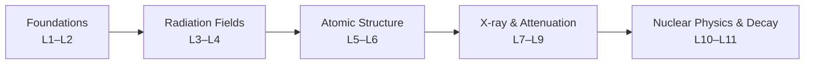

# MP500K · Radiation Physics · Exam 1 Review

> Duke Kunshan University · Fall 2026  
> **English keywords + Chinese explanations · Lecture-based study notes**  
> Coverage: **Lectures 1–11**, organized into **5 modules**.

These notes are an independently written study aid based on the **Fall 2026 MP500K lecture slides** and **Exam 1 Review Guide**. They are **not** official course materials, an answer key, or a substitute for the slides. The original course PDFs are **not redistributed** here.

## Start here

| Module | Lectures | Main focus | Notes |
|:--|:--|:--|:--|
| **01** | L1–L2 | Overview, forces, particles, relativity and wave–particle duality | [Module 01](modules/01_L1-L2_Foundations.md) |
| **02** | L3–L4 | Ionizing radiation, Poisson statistics, fluence, angular/energy distributions | [Module 02](modules/02_L3-L4_Ionizing_Radiation.md) |
| **03** | L5–L6 | Bohr model, spectra, quantum numbers and electron configurations | [Module 03](modules/03_L5-L6_Atomic_Structure.md) |
| **04** | L7–L9 | X-ray production, filtration, attenuation, buildup | [Module 04](modules/04_L7-L9_Xray_Attenuation.md) |
| **05** | L10–L11 | Nuclear structure, binding energy, shell model, decay modes and Q-values | [Module 05](modules/05_L10-L11_Nuclear_Decay.md) |

**Want one file?** See [the complete combined review](MP500K_Exam1_Complete_Review.md).

## Learning sequence

## Exam guide priorities

These labels follow the **2026 Exam 1 Review Guide**:

- **Basic (A−):** essentials such as radiation classification, fluence, atom models, quantum numbers, X-ray production/quality, exponential attenuation, nuclear structure, binding energy and decay modes.
- **Solid (A):** relativity, uncertainty, Bohr radius/velocity, hydrogen spectral series, beam hardening, narrow/broad beams, nuclear shell model and decay-energy calculations.
- **Advanced (A+):** differential and planar fluence, alternative fluence, multi-electron atoms and liquid drop model.

### Exam approach

1. Understand **physical interpretation** and **units** before memorizing equations.
2. Know which equations assume **monoenergetic photons**, **narrow-beam counting**, **single-electron atoms**, **atomic vs nuclear masses**, etc.
3. Show the equation, substitution and units; the review guide expressly mentions partial credit for intermediate work.
4. Compare diagrams: energy levels, radiation spectra, attenuation geometry, nuclear stability and decay schemes.

## Core constants

| Constant | Value |
|:--|:--|
| Speed of light $c$ | $2.998\times10^8\ \mathrm{m/s}$ |
| Planck constant $h$ | $6.626\times10^{-34}\ \mathrm{J\,s}$ |
| $hc$ | $\approx1240\ \mathrm{eV\,nm}$ |
| Electron rest energy | $m_ec^2=0.511\ \mathrm{MeV}$ |
| Proton rest energy | $m_pc^2\approx938.272\ \mathrm{MeV}$ |
| Neutron rest energy | $m_nc^2\approx939.565\ \mathrm{MeV}$ |
| Atomic mass conversion | $1\ \mathrm{u}\,c^2=931.494\ \mathrm{MeV}$ |
| Bohr radius $a_0$ | $0.529\ \text{Å}$ |
| Nuclear length scale | $1\ \mathrm{fm}=10^{-15}\ \mathrm m$ |

## Course source map

| Note | Corresponding lecture file(s) |
|:--|:--|
| Module 01 | `DKU_MP500K_Fall_2026_Lecture_1.pdf`, `_Lecture_2.pdf` |
| Module 02 | `..._Lecture_3.pdf`, `..._Lecture_4.pdf` |
| Module 03 | `..._Lecture_5.pdf`, `..._Lecture_6.pdf` |
| Module 04 | `..._Lecture_7.pdf`, `..._Lecture_8.pdf`, `..._Lecture_9.pdf` |
| Module 05 | `..._Lecture_10.pdf`, `..._Lecture_11.pdf` |
| Exam priorities | `DKU_MP500K_Fall_2026_Exam_1_Review.pdf` |

> **Source-sensitive notes:** Nuclear-radius constants and some effective-charge and liquid-drop approximations vary across texts; notes flag the lecture-specific convention. For exam questions, use the instructor's stated assumptions. Diagram descriptions are textual; open the cited lecture pages to see the instructor's original figures.

## GitHub usage

Upload the **contents** of this folder to a GitHub repository. GitHub renders Markdown math (`$...$`, `$$...$$`), tables, and Mermaid diagrams. Click through from `README.md` to each module; no build step is required.

*Educational reference, not submitted homework solutions.*
