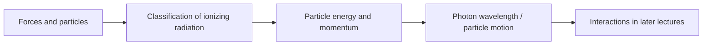

# Module 01 — L1–L2: Medical Physics and Modern Physics

[← Home](../README.md) · [Next: Module 02 →](02_L3-L4_Ionizing_Radiation.md)

**Source:** `Lecture_1.pdf` (overview of medical/radiation physics), `Lecture_2.pdf` (modern physics).  
**Exam guide:** four subspecialties/history/forces/particle–wave duality/classification = **Basic**; fundamental particles/relativity/uncertainty = **Solid**.

## L1 — Overview of Medical Physics

### 1. Medical physics as a multidisciplinary field

Medical physics applies **physics, mathematics, chemistry, engineering, computing/AI, and biology** to medicine. L1 describes three career directions: **clinic, industry, research**.

Four subspecialties:

| Subspecialty | Main work | Typical technologies |
|:--|:--|:--|
| Diagnostic imaging physics | Image quality, acquisition and patient safety | X-ray, CT, MRI, ultrasound |
| Radiation therapy physics | Treatment delivery and dosimetry | LINAC, proton beams, brachytherapy |
| Nuclear medicine physics | Radiotracer imaging and therapy | PET, SPECT |
| Health physics / radiation protection | Risk control and shielding | Time, distance, shielding |

**Ionizing imaging:** X-ray radiography, CT, PET, SPECT. **Non-ionizing:** MRI, ultrasound. The imaging modality can be the same diagnostic goal but use a very different physical mechanism.

### 2. Historical context

Core milestones highlighted in lecture/homework context include **Röntgen's X-rays (1895)**, **Becquerel's radioactivity (1896)**, research by **the Curies**, **Bohr's atomic model (1913)**, and later medical applications including **Co-60 therapy, CT, MRI and PET**. Nobel details often confused: **Röntgen — 1901 Physics**; **Einstein — 1921 Physics, especially photoelectric law**; **CT: Cormack/Hounsfield — 1979 Medicine**; **MRI: Lauterbur/Mansfield — 2003 Medicine**.

### 3. Radiation protection essentials

- **Time:** at constant dose rate, accumulated exposure increases with time.
- **Distance:** an ideal point source in free space follows approximately $I\propto 1/r^2$.
- **Shielding:** use suitable material/thickness, considering spectrum, workload, geometry and occupancy.

## L2 — Review of Basic Concepts in Modern Physics

### 1. Four fundamental forces

| Force | Approx. relative strength (lecture convention) | Typical range | Relevance |
|:--|--:|:--|:--|
| Strong | $1$ | $\sim10^{-15}\ \mathrm m$ | Nuclear binding |
| Electromagnetic | $1/137$ | Long-range | Atomic interactions, charged particles |
| Weak | $\sim10^{-6}$ | $\sim10^{-18}\ \mathrm m$ | Beta decay |
| Gravitational | $\sim10^{-39}$ | Long-range | Negligible in atomic-scale radiation physics |

These strengths are **order-of-magnitude teaching conventions**, not universal energy-independent ratios.

### 2. Fundamental particles

- **Quarks:** up ($+2e/3$), down ($-e/3$), and four additional flavors. Proton $uud$; neutron $udd$.
- **Hadrons:** particles subject to strong interactions; includes baryons (proton/neutron) and mesons.
- **Leptons:** electron, muon, tau and corresponding neutrinos. Neutrino and antineutrino must not be swapped when writing beta decay.

### 3. Classification of radiation

**Directly ionizing:** charged particles (electron, positron, proton, alpha, carbon ions) deposit energy via Coulomb interactions.  
**Indirectly ionizing:** uncharged photons/neutrons first create energetic charged particles, which then ionize matter.

### 4. Special relativity and relativistic relations

Define $\beta=v/c$ and the **Lorentz factor**:

$$
\gamma=\frac{1}{\sqrt{1-\beta^2}}.
$$

| Quantity | Equation | Interpretive caution |
|:--|:--|:--|
| Time dilation | $\Delta t=\gamma\Delta\tau$ | $\Delta\tau$ is proper time |
| Length contraction | $L=L_0/\gamma$ | Along direction of relative motion |
| Total energy | $E=\gamma m_0c^2$ | Includes rest energy |
| Rest energy | $E_0=m_0c^2$ | Electron: 0.511 MeV |
| Kinetic energy | $K=(\gamma-1)m_0c^2$ | $K\ne E$ |
| Momentum | $p=\gamma m_0v$ | $p$ is not generally $m_0v$ |
| Energy–momentum | $E^2=(pc)^2+(m_0c^2)^2$ | Works for massive particles and photons |

**Terminology:** Some homework asks for “relativistic mass” $\gamma m_0$; modern treatments commonly retain invariant rest mass $m_0$.

### 5. Particle–wave duality

For a **photon**:

$$
E=h\nu=\frac{hc}{\lambda},\qquad p=\frac E c=\frac h\lambda.
$$

For a **material particle** (de Broglie relation):

$$
\lambda=\frac hp.
$$

- Higher photon frequency $\nu$ means higher photon energy.
- Shorter wavelength $\lambda$ means higher photon energy.
- Distinguish Greek **$\nu$ (frequency)** from Latin **$v$ (speed)**.

### 6. Heisenberg uncertainty principle

$$
\Delta x\,\Delta p_x\ge\frac{\hbar}{2},\qquad \Delta E\,\Delta t\gtrsim\frac{\hbar}{2}.
$$

Position and conjugate momentum cannot simultaneously have arbitrary precision; the energy–time relation has a distinct interpretation from a pair of position/momentum operators.

## Concept connections

### Can you explain without notes?

- Why is PET ionizing but MRI non-ionizing?
- Why is $K=(\gamma-1)m_0c^2$ instead of $\gamma m_0c^2$?
- Why do photons of different energies still travel at $c$ in vacuum?
