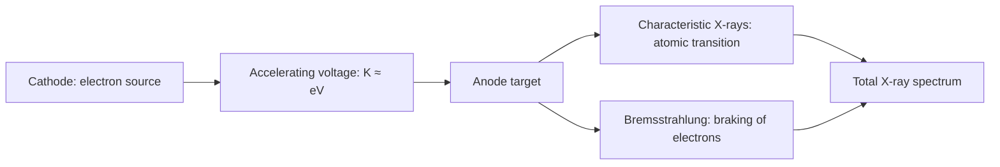

# Module 04 — L7–L9: X-ray Production, Quality and Attenuation

[← Home](../README.md) · [← Module 03](03_L5-L6_Atomic_Structure.md) · [Next: Module 05 →](05_L10-L11_Nuclear_Decay.md)

**Source:** `Lecture_7.pdf` (X-ray production/characteristic), `Lecture_8.pdf` (bremsstrahlung and quality), `Lecture_9.pdf` (attenuation).  
**Exam guide:** X-ray production/quality and exponential attenuation = **Basic**; beam hardening, narrow/broad beam, buildup = **Solid**.

## L7 · 1–2. Properties of X-rays

X-rays are photons with $E=h\nu=hc/\lambda$ and $p=h/\lambda=E/c$. Lecture's approximate range: **0.1–1000 keV**. X-ray tube voltage determines accelerating-electron energy; distinguish **kVp** (tube voltage) from **keV** (photon energy).

## L7 · 3. X-ray tube and production



### Characteristic X-rays

An inner-shell electron is ejected → vacancy → outer-shell electron transitions inward → emits **characteristic photon** (or releases **Auger electron**, a competing atomic relaxation).

$$
E_X\approx B_{inner}-B_{outer}.
$$

| Transition | Label | Relative energy |
|:--|:--|:--|
| L → K | Kα | Lower than Kβ |
| M → K | Kβ | Higher than Kα |
| N → K | Kγ | Higher than Kβ (simplified ordering) |

**Tungsten peaks (L7 p. 17):** Kα₁ ≈ 59.32 keV, Kα₂ ≈ 57.98 keV, Kβ₁ ≈ 67.24 keV. The fine structure of electron subshells creates closely spaced lines.

**Fluorescence yield $\omega$:** probability that a specified shell vacancy relaxes radiatively (via characteristic X-ray). In a simple radiative vs non-radiative partition, Auger probability ≈ $1-\omega$. Higher-$Z$ atoms generally have greater **K-shell fluorescence yield**. This probability is **not** photon escape probability.

## L8 · 3. Bremsstrahlung

A fast electron loses a variable amount of kinetic energy through electromagnetic interaction with a nucleus. The emitted photon energies form a **continuous spectrum**:

$$
E_\gamma=K_i-K_f,\qquad E_{\gamma,max}\approx K_i\approx eV_{max}.
$$

**Duane–Hunt law:**

$$
\lambda_{min}=\frac{hc}{E_{\gamma,max}}=\frac{hc}{eV_{max}}.
$$

**Thin-target approximation:** lecture illustrates nearly constant differential **radiant-energy spectrum**, $R(E)=N(E)E\approx C$.  
**Thick-target approximation (lecture units $T_0$ in MeV):**

$$
R\approx10^{-3}N_eZT_0^2\ \mathrm{MeV},\qquad
Y\approx10^{-3}ZT_0.
$$

These are **approximate** teaching formulas, not general equipment calibration laws.

**Interpret spectrum comparisons (L8 p. 9):**

- Raise electron count $N_e$ → quantity scales up, cutoff $E_{max}$ unchanged.
- Raise target $Z$ in the simplified model → more bremsstrahlung, similar endpoint.
- Raise initial electron kinetic energy $T_0$ → higher endpoint and substantially larger integrated radiation energy.

### Spectrum anatomy

```text
Intensity
  ^                 | Kα   | Kβ      Discrete characteristic lines
  |        _____    |      |
  |      /      \   |      |
  |_____/        \__|______|____________> Photon energy
                         continuous bremsstrahlung → endpoint Emax
```

The schematic illustrates components, **not a measured spectrum**. The continuous background goes to a maximum energy; characteristic peaks sit at material-dependent energies.

## L8 · 4. Quantity, quality and beam hardening

| Quantity | Quality |
|:--|:--|
| Number/output of photons | Penetrability and spectral hardness |
| Primarily mA and exposure time (mAs) | Strongly influenced by kVp and filtration |

**HVL:** absorber thickness giving half the **measured** intensity. For a monoenergetic narrow beam:

$$
HVL=\frac{\ln2}{\mu}.
$$

**Beam hardening:** a polychromatic beam loses low-energy photons preferentially, so its **mean transmitted energy increases** while **total fluence/energy fluence generally decreases**. No individual photon is “hardened.” See **L8 pp. 11–12** diagrams (low-energy region disproportionately suppressed).

Near regions away from absorption edges, photoelectric mass attenuation may be illustrated by the approximate scaling $\tau/\rho\propto Z^3/E^3$. This is **not** an exact all-energy expression.

## L8 · 5. Filtration

- **Inherent filtration:** target, X-ray tube glass, insulating oil and other built-in materials.
- **Added filtration:** selected materials such as aluminum or copper.
- **Purpose:** remove photons with little useful penetration but substantial patient absorption; modify beam quality.
- Higher-$Z$ filters can introduce absorption-edge features; lower-$Z$ filtration may produce smoother spectra.

**Distinction:** *filtration* is an engineered method; *beam hardening* is the resulting spectral selection effect. Filtering does **not** produce a perfectly monoenergetic spectrum.

## L9 · 1–2. Exponential attenuation

Primary, *uncollided* photons of a **monoenergetic**, well-defined beam in a **homogeneous** material follow:

$$
I(L)=I_0e^{-\mu L},\qquad N_L=N_0e^{-\mu L}.
$$

- $\mu$ = **linear attenuation coefficient**, units $\mathrm{cm^{-1}}$ or $\mathrm{m^{-1}}$.
- For a short distance $dL$, interaction probability ≈ $\mu\,dL$.
- Derivation: $dN/N=-\mu\,dL$; integrate $\Rightarrow\ln(N_L/N_0)=-\mu L$.
- **Microscopic interpretation:** $e^{-\mu L}$ is one particle's probability of **no interaction**.
- **Macroscopic interpretation:** expected surviving **uncollided fraction** of many particles.

$$
\lambda_{mfp}=\frac1\mu,\qquad HVL=\frac{\ln2}{\mu}.
$$

After one mean free path, survival $e^{-1}\approx36.8\%$ (not zero). With multiple interaction channels:

$$
\mu=\sum_i\mu_i,\qquad
\Delta N_i=(N_0-N_L)\frac{\mu_i}{\mu}.
$$

An interaction that removes a photon from the **primary beam** may be scattering rather than complete energy absorption.

## L9 · 3. Narrow-beam attenuation

**Only uncollided primary particles count.** A collimated narrow-beam detector geometry helps reject scattered/secondary photons; published narrow-beam coefficients usually refer to this primary-only definition. A physically broad detector can still measure primary-only signal if it **discriminates** nonprimaries by direction, energy or other method (L9 p. 18).

## L9 · 4. Broad-beam attenuation

**Some scattered and/or secondary radiation reaches and is counted by the detector.** Broad beam is a **measurement/geometry-dependent** response, not a new intrinsic material attenuation coefficient.

- **Out-scattering:** particles initially directed toward detector scatter away.
- **In-scattering:** particles initially headed elsewhere scatter into detector.
- L9 pp. 20–21 plot compares narrow vs broad geometries; more broad geometry may mean more detected scatter and slower apparent attenuation. The lecture's plot uses **fast neutrons through steel** as an illustrative example.

## L9 · 5. Buildup factor

For a specified quantity (e.g. energy fluence, exposure or dose):

$$
B=\frac{\text{primary + scattered + secondary contribution}}{\text{primary-only contribution}}.
$$

For **energy fluence**, matching quantity to numerator and denominator:

$$
B=\frac{\Psi_P+\Psi_S+\Psi_{2nd}}{\Psi_P},\qquad
\frac{\Psi_L}{\Psi_0}=Be^{-\mu L}.
$$

Define effective coefficient for a **specified** thickness/geometry:

$$
Be^{-\mu L}=e^{-\mu' L}\quad\Rightarrow\quad
\boxed{\mu'=\mu-\frac{\ln B}{L}}.
$$

- **Narrow beam:** $B=1$ (primary only).
- **Broad beam:** typically $B>1$ when scattered/secondary contributions are counted.
- For $B>1$, $\mu'<\mu$ is the **apparent/effective** coefficient; the narrow-beam material $\mu$ did **not** change.

**L9 p. 24 buildup charts:** horizontal axis $\mu L$ counts **mean free paths**, not cm; curves depend on **material, energy, geometry and measured quantity**. An **exposure** buildup factor cannot automatically be reused as an **energy-fluence** buildup factor.

### Can you explain without notes?

- Why can increasing kVp change the endpoint while increasing mAs cannot?
- Why can energy fluence decline while mean transmitted photon energy rises?
- Why does a broad-beam setup need a buildup factor when a primary-only measurement does not?
