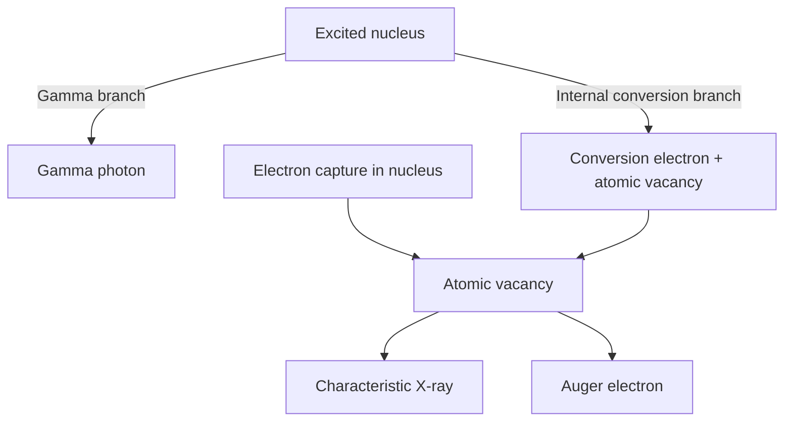

# Module 05 — L10–L11: Nuclear Structure and Radioactive Decay

[← Home](../README.md) · [← Module 04](04_L7-L9_Xray_Attenuation.md)

**Source:** `Lecture_10.pdf` pp. 3–40; `Lecture_11.pdf` pp. 3–30.  
**Exam guide:** nuclear structure, Coulomb force/potential, nuclides, stability, binding energy, decay modes = **Basic**; shell model and decay energy = **Solid**; liquid drop model = **Advanced**.

## L10 · 1–2. Basic structure of the nucleus

The nucleus consists of **protons** ($+e$, $m_pc^2\approx938.272\ \mathrm{MeV}$) and **neutrons** (neutral, $m_nc^2\approx939.565\ \mathrm{MeV}$). Both are spin-$1/2$ **nucleons**.

### Coulomb and strong nuclear forces

$$
F_C=\frac{k_0q_1q_2}{r^2},\qquad U_C=\frac{k_0q_1q_2}{r},\qquad
k_0=\frac1{4\pi\varepsilon_0}.
$$

- Two protons repel electrically; as they approach, their **positive Coulomb potential energy** increases.
- The **strong nuclear force** is attractive over a short, roughly femtometer range and acts approximately independent of nucleon electric charge.
- **L10 pp. 8–9 diagrams:** proton–nucleus potential has an external **Coulomb barrier** and an attractive interior **nuclear well**. A neutron has no corresponding electric repulsive barrier, though nuclear reaction probability still depends on energy/cross section.

### Nuclide notation and categories

$$
{}^A_ZX,\qquad A=Z+N,
$$

where $Z$ = protons, $N$ = neutrons and $A$ = nucleons.

| Category | Invariant | Example (L10 p. 11) |
|:--|:--|:--|
| **Isotopes** | Same $Z$ | $^{16}O,\ ^{17}O$ |
| **Isotones** | Same $N$ | $^{13}C,\ ^{14}N$ |
| **Isobars** | Same $A$ | $^{14}C,\ ^{14}N$ |
| **Isomers** | Same $Z,A$, different nuclear states | $^{99m}Tc,\ ^{99}Tc$ |

### Radius and density

**Lecture 10 convention** (p. 13):

$$
R=r_0A^{1/3},\qquad r_0\approx1.3\ \mathrm{fm},\qquad 1\ \mathrm{fm}=10^{-15}\ \mathrm m.
$$

Since $R^3\propto A$ and nuclear mass $\propto A$, the approximate nuclear density is **roughly constant**, $\rho\approx1.8\times10^{17}\ \mathrm{kg/m^3}$ (lecture example). Different references may use $r_0\sim1.2\ \mathrm{fm}$—**do not silently mix conventions**.

## L10 · 3. Stability of nucleus

The nucleus balances short-range attractive binding with long-range proton–proton electrostatic repulsion. In the **$N$–$Z$ chart** (L10 p. 15):

- For light stable nuclei, $N/Z\approx1$.
- Heavier stable nuclei increasingly require **neutron excess**; stable band bends above $N=Z$.
- With **$Z$ horizontal** and **$N$ vertical**: isotopes = vertical lines, isotones = horizontal lines, isobars = $N+Z=\mathrm{constant}$ diagonals.
- This is a **stability band** trend, not an absolute criterion. Shell closures, pairing and energy balance also matter.

## L10 · 4. Mass defect and binding energy

A bound nucleus has less rest mass than separate nucleons:

$$
\Delta m=Zm_p+(A-Z)m_n-M_{nucleus},\qquad
BE=\Delta m\,c^2.
$$

Useful conversion:

$$
1\ \mathrm u\,c^2=931.494\ \mathrm{MeV}.
$$

**Atomic mass bookkeeping:** if using **neutral atomic** mass $M_{atom}$, a convenient approximate form is:

$$
BE\approx[Zm_H+(A-Z)m_n-M_{atom}]c^2,
$$

where $m_H$ = **neutral hydrogen-atom mass**. Do not combine a neutral-atom mass with bare proton mass without accounting for electrons.

### Binding energy per nucleon and the curve

$$
\frac{BE}{A}\ \text{(MeV/nucleon)}.
$$

**L10 pp. 23–25:** binding energy per nucleon rises rapidly at low $A$, has a broad maximum in the **Fe/Ni region**, then falls gradually for heavy nuclei.

- **Fusion:** some light nuclei combine into a more tightly bound final system; release energy if final total rest mass decreases.
- **Fission:** some heavy nuclei fragment into more tightly bound products; release energy if final total rest mass decreases.

**Important distinction:** high $BE/A$ signals average nucleon binding, not proof of absolute stability against all decay channels.

## L10 · 5. Liquid drop model (Advanced)

Nucleons are treated collectively like constituents of a nearly constant-density fluid droplet. Lecture's five terms:

1. **Volume:** $+C_1A$ — bulk attractive binding.
2. **Surface:** $-C_2A^{2/3}$ — surface particles have fewer neighbors.
3. **Coulomb:** $-C_3Z(Z-1)/A^{1/3}$ — proton repulsion.
4. **Asymmetry:** $-C_4(A-2Z)^2/A$ — imbalance of proton and neutron populations.
5. **Pairing:** $+C_5C_p/A$ — lecture-specific parametrization of even/odd energy correction.

**Lecture 10 p. 31 form:**

$$
BE=C_1A-C_2A^{2/3}-C_3\frac{Z(Z-1)}{A^{1/3}}-
C_4\frac{(A-2Z)^2}{A}+C_5\frac{C_p}{A}.
$$

**Lecture coefficients (MeV):** $C_1=15.75$, $C_2=17.80$, $C_3=0.711$, $C_4=23.70$, $C_5=11.18$. $C_p=+1$ for even–even, $0$ for odd $A$, $-1$ for odd–odd nuclei.

**Source note:** alternative textbooks use a *different power of $A$* and fitted coefficients for the pairing term; this expression preserves **this lecture's convention**, not an interchangeable universal parametrization.

The liquid drop model averages nucleons; it does not directly explain **magic numbers**.

## L10 · 6. Nuclear shell model (Solid)

Treat proton and neutron motion through **quantized nuclear energy levels**, with substantial spin–orbit splitting.

**Magic numbers:**

$$
\boxed{2,\ 8,\ 20,\ 28,\ 50,\ 82,\ 126}.
$$

A complete proton or neutron shell often yields extra stability. Proton and neutron occupation patterns are treated **separately**.

### Subshell labels

A label such as $1d_{5/2}$ means:

- **1**: radial level/index in the **nuclear** notation.
- **d**: orbital angular momentum $l=2$.
- **5/2**: total nucleon angular momentum $j=5/2$.

For spin-$1/2$ nucleons:

$$
j=l\pm\frac12,\qquad \boxed{\text{capacity of subshell}=2j+1}.
$$

| Subshell | $j$ | Capacity per nucleon species |
|:--|:--:|--:|
| $1s_{1/2}$ | $1/2$ | 2 |
| $1p_{3/2}$ | $3/2$ | 4 |
| $1p_{1/2}$ | $1/2$ | 2 |
| $1d_{5/2}$ | $5/2$ | 6 |
| $2s_{1/2}$ | $1/2$ | 2 |
| $1d_{3/2}$ | $3/2$ | 4 |
| $1f_{7/2}$ | $7/2$ | 8 |

**L10 p. 37 figure:** after filling cumulative capacities **2, 8, 20, 28**, observe corresponding magic numbers. The $1p$, $1d$, etc. states split because of **nuclear spin–orbit coupling**.

### Nuclear ground-state spin $J$

- **Even–even:** typically $J=0$.
- **Odd-A:** typically determined by the unpaired nucleon's $j$.
- **Odd–odd:** unpaired proton and neutron angular momenta must be **coupled**; in general $J=|j_p-j_n|,\ldots,j_p+j_n$, with actual ground state set by interactions.

Lecture example **$^{17}O$** has $Z=8$ and $N=9$; one neutron occupies $1d_{5/2}$ beyond the 8-neutron closure, producing $J=5/2$ in the simple shell picture.

## L11 · 1. Radioactive decay and conservation

**Radioactivity:** spontaneous disintegration/rearrangement of an unstable nucleus, accompanied by radiation. **Parent** → **daughter** + emitted particles/radiation. Conservation of charge, nucleon number, energy (including rest mass), momentum and angular momentum; beta processes also require lepton-number bookkeeping.

## L11 · 2. Alpha decay and Q value

$$
{}^A_ZP\longrightarrow{}^{A-4}_{Z-2}D+{}^4_2He,
$$

$$
Q_\alpha=(M_P-M_D-M_\alpha)c^2.
$$

Here the formula uses **nuclear masses**; neutral atomic masses require consistent helium-atom mass bookkeeping. For an initially stationary parent, a two-body, nonrelativistic decay:

$$
Q_\alpha=K_D+K_\alpha,\qquad
K_\alpha=Q_\alpha\frac{M_D}{M_D+M_\alpha}\approx Q_\alpha\frac{A-4}{A}.
$$

Equal-and-opposite daughter/alpha momentum implies the **lighter alpha** takes most of the kinetic energy. Fixed two-body branch → a **discrete alpha energy**.

## L11 · 3. Decay scheme and branches

A **decay scheme** encodes parent/daughter nuclear levels, decay pathways, branching ratios and subsequent gammas.

- Arrow slanting **left**: $Z$ decreases.
- Arrow slanting **right**: $Z$ increases.
- Wavy **downward** transition: gamma emission between nuclear levels.

**L11 p. 15 Ra-226 diagram:** two alpha branches, about **94.6%** directly to ground-state Rn-222 and **5.4%** to an excited state; a subsequent gamma can release its energy. Alpha branches correspond to different discrete alpha energies.

## L11 · 4. Beta decay

**All these beta transformations keep mass number $A$ unchanged.** A daughter and parent are isobars.

### Beta minus $\beta^-$ (neutron-rich → more protons)

$$
n\rightarrow p+e^-+\bar\nu_e,\qquad
{}^A_ZP\rightarrow{}^A_{Z+1}D+e^-+\bar\nu_e.
$$

### Beta plus $\beta^+$ (proton-rich → more neutrons)

$$
p\rightarrow n+e^++\nu_e,\qquad
{}^A_ZP\rightarrow{}^A_{Z-1}D+e^++\nu_e.
$$

**Use neutrino $\nu_e$ vs antineutrino $\bar\nu_e$ correctly.** The beta electron/positron energy is a **continuous distribution** because energy is shared with a neutrino and the recoiling daughter, unlike a fixed two-body alpha branch.

### Atomic-mass Q-value formulas (neutral atoms)

$$
\boxed{Q_{\beta^-}=[M_P-M_D]c^2}
$$

$$
\boxed{Q_{\beta^+}=[M_P-M_D-2m_e]c^2}
$$

A free positron costs rest energy, and changing neutral atomic electron bookkeeping produces the second $m_e$. Thus a possible $\beta^+$ channel requires roughly $[M_P-M_D]c^2\ge1.022\ \mathrm{MeV}$.

Lecture L11 pp. 20 and 23 shows a **continuous** beta spectrum. “Mean beta kinetic energy $\sim$ one third of endpoint” is a **rough lecture approximation**, not a fixed law for all beta spectra.

## L11 · 5. Electron capture (EC)

$$
p+e^-\rightarrow n+\nu_e,\qquad
{}^A_ZP+e^-\rightarrow{}^A_{Z-1}D+\nu_e.
$$

The orbital electron usually originates from an inner shell; its capture creates an **atomic vacancy**. Subsequent relaxation may emit a **characteristic X-ray or Auger electron**.

**Mass bookkeeping needs care:** using neutral atomic masses, the **total mass-difference Q value** is approximately

$$
Q_{EC,total}=[M_P-M_D]c^2.
$$

If the daughter nucleus is in an excited state and the captured electron has binding energy $B_i$, the **neutrino + recoil available kinetic energy** is approximately

$$
K_\nu+K_D\approx Q_{EC,total}-E_{exc}-B_i.
$$

L11 pp. 25–26 writes the **available kinetic-energy expression** as a $Q$ with the $B_i$ subtraction. This should **not be confused** with the total neutral-atom mass-difference Q convention.

## L11 · 6. Gamma decay and isomers

$$
{}^A_ZX^*\rightarrow{}^A_ZX+\gamma,\qquad
E_\gamma\approx E_i-E_f.
$$

- $\Delta Z=0$, $\Delta A=0$: nuclear energy changes but nucleon identity does not.
- Discrete gamma energies follow from discrete nuclear levels (ignoring small recoil).
- Long-lived excited nuclear states are **isomers/metastable** states, e.g. $^{99m}Tc$; their de-excitation is called **isomeric transition (IT)**.

## L11 · 7. Internal conversion (IC)

A nuclear transition directly transfers energy to an **orbital electron**, ejecting it **instead of** emitting a gamma photon:

$$
K_{IC}\approx\Delta E_{nuc}-B_i-E_{recoil}.
$$

IC produces an atomic vacancy, which can subsequently relax through characteristic X-ray or Auger emission. **IC is not photoelectric absorption of an already-emitted gamma photon.**

**Internal conversion coefficient** (lecture p. 30):

$$
\boxed{\alpha_{IC}=\frac{N_{IC}}{N_\gamma}}.
$$

It is a **ratio of competing branch rates**, not a probability. With only gamma and IC transitions, $P_{IC}=\alpha_{IC}/(1+\alpha_{IC})$.

## Six decay-process comparison

| Process | $\Delta Z$ | $\Delta A$ | Main emitted product(s) | Typical spectrum |
|:--|--:|--:|:--|:--|
| Alpha | −2 | −4 | $\alpha$ | Discrete by branch |
| Beta minus | +1 | 0 | $e^-+\bar\nu_e$ | Continuous $e^-$ |
| Beta plus | −1 | 0 | $e^++\nu_e$ | Continuous $e^+$ |
| Electron capture | −1 | 0 | $\nu_e$ (+ atomic relaxation) | Branch-dependent |
| Gamma | 0 | 0 | $\gamma$ | Discrete |
| Internal conversion | 0 | 0 | orbital $e^-$ (+ relaxation) | Discrete lines |

### Nuclear vs atomic electron processes

### Can you explain without notes?

- Why does the proton potential-energy diagram show a barrier that the neutron diagram lacks?
- What does $1d_{5/2}$ mean and how many neutrons can that subshell hold?
- Why is $Q_{\beta^+}$ different from $Q_{\beta^-}$ for **neutral atomic masses**?
- Why is beta spectrum continuous but a specified gamma line discrete?
- How are **IC electrons**, **Auger electrons** and **characteristic X-rays** linked and distinguished?
